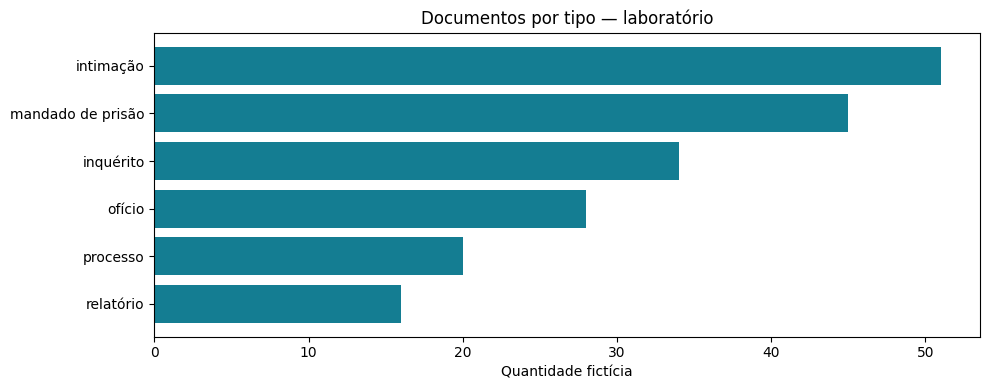
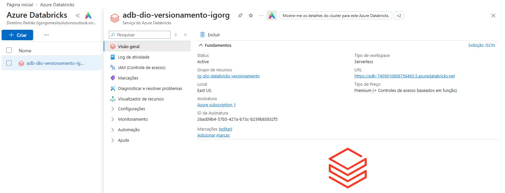
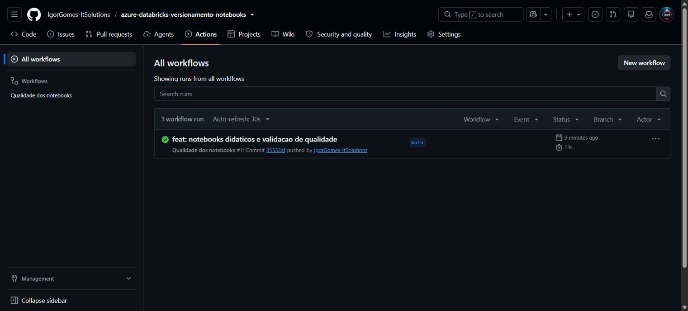
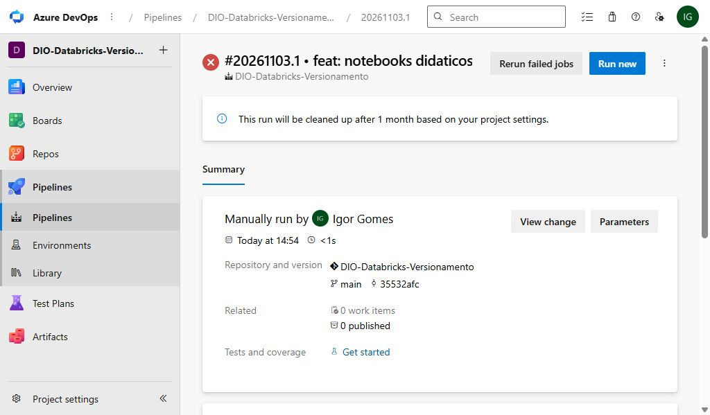
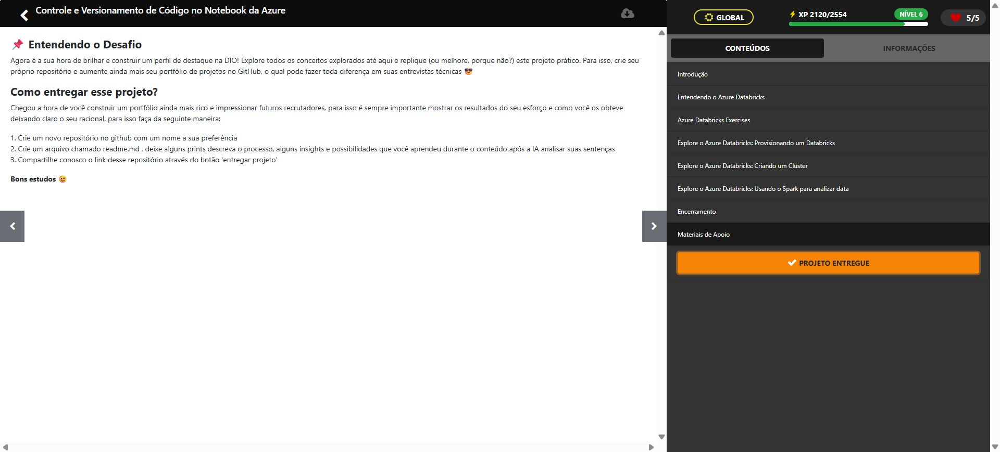

# Versionamento de notebooks no Azure Databricks

Laboratório para o desafio DIO **Controle e Versionamento de Código no Notebook da Azure**. Analisa documentos inteiramente fictícios com Python, PySpark e SQL, incluindo regras de qualidade, filtros, sumarização e gráfico.

## Entregáveis

- [Notebook Databricks em código-fonte](notebooks/01_documentos.py) e [formato Jupyter importável](notebooks/01_documentos.ipynb).
- [CSV fictício](data/documentos.csv) com duplicata e registros inválidos intencionais.
- Regras Python e três testes automatizados.
- CI no GitHub Actions e configuração equivalente em [Azure Pipelines](azure-pipelines.yml).
- [Roteiro de importação, Git, IA e operação](docs/operacao.md).

## Contrato de dados

| Indicador | Resultado esperado |
|---|---:|
| Registros de entrada | 9 |
| Tipos válidos após limpeza | 6 |
| Rejeitados | 2 |
| Duplicatas idênticas removidas | 1 |
| Total de documentos | 194 |
| Total dos tipos acima de 30 | 130 |

Os tipos acima de 30 representam 67,01% do total. Valores negativos e nomes vazios são rejeitados. IDs iguais com conteúdos diferentes causam falha explícita, evitando escolher registros arbitrariamente.

## Validação e estado de execução

Os três testes Python passaram localmente em 03/11/2026, e a sintaxe dos arquivos Python foi validada. A mesma validação passou no [GitHub Actions, execução 41687578380](https://github.com/IgorGomes-ItSolutions/azure-databricks-versionamento-notebooks/actions/runs/41687578380).

O workspace Azure `adb-dio-versionamento-igorg` está ativo em East US, no tipo Premium/Serverless, com a assinatura existente. A organização Azure DevOps e o projeto `DIO-Databricks-Versionamento` foram criados; o repositório foi importado no Azure Repos e a esteira YAML foi cadastrada. A primeira execução no DevOps não encontrou agente compatível disponível (`No agent found in pool Azure Pipelines`). Nenhum resultado de teste executado no agente Azure é alegado.

A importação foi realizada pela CLI oficial após autorização OAuth manual. O notebook executou com **SUCCESS** no Azure Databricks em 03/11/2026: 57 segundos de execução e aproximadamente 64 segundos no total, incluindo preparação. As verificações Spark/SQL passaram. O gráfico abaixo foi extraído dessa execução real.

Consulte o [notebook com resultados executados](notebooks/01_documentos_executado.ipynb), os [resultados das células](docs/resultados-celulas.json), os [metadados do run](docs/resultado-azure.json) e o [histórico de execução](docs/execucao-azure.md). A versão importável sem saídas continua disponível para reaproveitamento.



### Evidências





```powershell
python -m unittest discover -s tests -v
python -m compileall -q src notebooks
```

## Organização e aprendizado

Python fornece listas, dicionários, leitura de arquivo e parâmetros. PySpark manipula DataFrames. SQL consulta a view temporária criada pelo notebook. As duas consultas são comparadas por verificações no próprio notebook.

O fluxo de versionamento é branch → revisão → testes → merge → artefato aprovado → importação no workspace. A promoção é manual para evitar execuções e custos inesperados. Código gerado com auxílio de IA deve ser revisado; não há alegação de uso do assistente nativo sem evidência.

## Custos e segurança

Somente dados fictícios; nenhum token ou senha no repositório. Limite autorizado para este laboratório: US$ 5 dos créditos existentes, sem migração da assinatura. A tentativa de plano Databricks Trial foi recusada porque a assinatura é Azure Free Trial; o workspace foi criado com Premium/Serverless na mesma assinatura. A tentativa em modo econômico atingiu o limite de espera. A segunda, em Performance Optimized, foi especificamente autorizada e concluída; não há agendamento recorrente.

O laboratório usa serverless em lugar de um cluster clássico mantido ativo. O custo definitivo depende do registro de cobrança do provedor; o tempo limite da tarefa não é um teto monetário automático. O projeto não cria agentes pagos no DevOps nem configura CD que inicie compute automaticamente.

As referências oficiais e o roteiro completo estão em [docs/operacao.md](docs/operacao.md).

## Entrega na DIO

Projeto submetido em 03/11/2026 ao desafio **Controle e Versionamento de Código no Notebook da Azure**. A plataforma confirmou **PROJETO ENTREGUE**.


